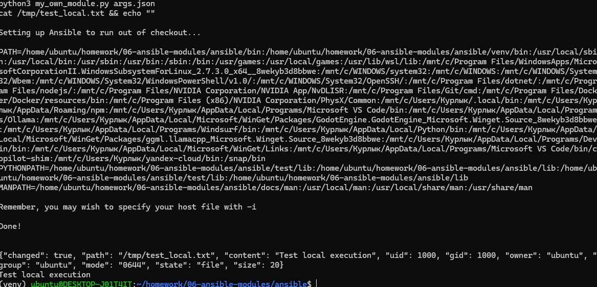
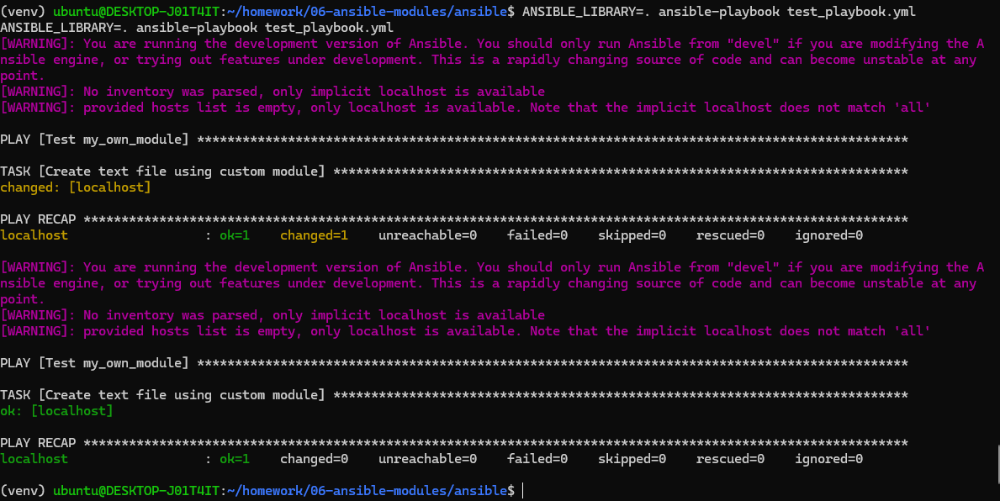
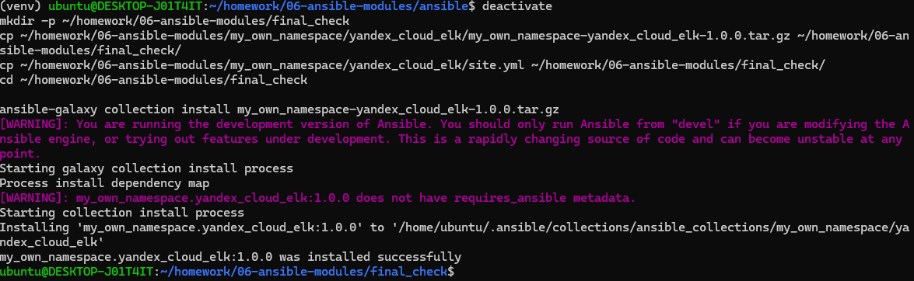
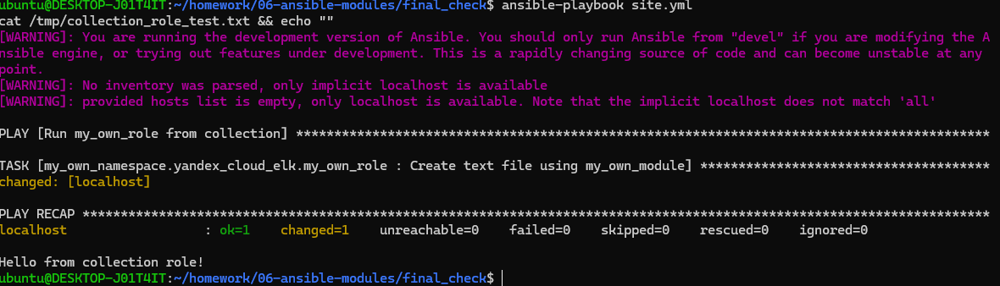

# Ansible Collection - my_own_namespace.yandex_cloud_elk

This collection contains a custom Ansible module `my_own_module` and a role `my_own_role` for creating text files with specified content on remote hosts.

## Included Content

### Modules
* **`my_own_namespace.yandex_cloud_elk.my_own_module`** — Creates a text file at the specified `path` with the given `content`.
  * `path` *(required, string)* — Path to the file to be created.
  * `content` *(optional, string, default: `""`)* — Content to write into the file.

### Roles
* **`my_own_namespace.yandex_cloud_elk.my_own_role`** — Single-task role that invokes `my_own_module`.
  * **Default variables** (`roles/my_own_role/defaults/main.yml`):
    * `file_path`: `"/tmp/default_role_file.txt"`
    * `file_content`: `"Default content from my_own_role"`

## Example Playbook

```yaml
---
- name: Run my_own_role from collection
  hosts: localhost
  connection: local
  gather_facts: false
  roles:
    - role: my_own_namespace.yandex_cloud_elk.my_own_role
      vars:
        file_path: "/tmp/collection_role_test.txt"
        file_content: "Hello from collection role!"
```

## Screenshots

### Step 4: Local module execution


### Step 6: Playbook idempotency check


### Step 15: Collection installation from local archive


### Step 16: Playbook execution with installed collection

